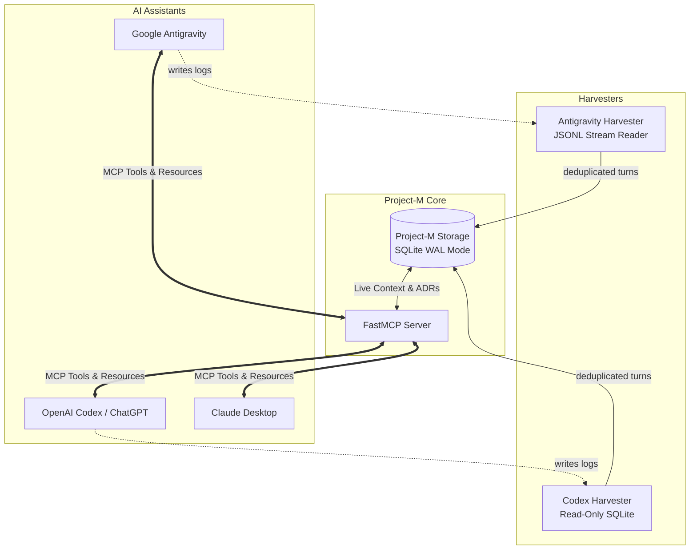

# 🧠 Project-M (MCP)

> **A local-first, zero-cloud Model Context Protocol (MCP) server & living project blackboard synchronizing state and architectural decisions across Claude Desktop, Google Antigravity, and OpenAI ChatGPT / Codex.**

[]()
[]()
[]()
[-lightgrey.svg)]()
[]()
[](https://m8ven.ai/mcp/adityadebnath009-project-m-177ur4?s=readme)

---

## 📌 The Problem

Modern developers frequently switch between multiple frontier AI assistants:
* **Google Antigravity** for agentic IDE workflows and deep codebase edits.
* **Anthropic Claude Desktop** for high-level architectural brainstorming and complex prompt reasoning.
* **OpenAI ChatGPT Desktop / Codex** for rapid coding iterations and testing.

However, **their contexts are siloed**. Decisions made in Claude are unknown to Antigravity. Tasks started in Antigravity are invisible to Codex. Developers are forced to constantly copy-paste summaries, diffs, and context between chat windows.

---

## 💡 The Solution

**Project-M** acts as an ambient, local-first blackboard connecting all three AI assistants:



* **Zero Cloud**: 100% local, runs on your machine.
* **Zero API Bills**: No expensive sync APIs or cloud database subscriptions.
* **Non-Invasive**: Non-blocking, read-only watchers inspect local assistant state without interrupting active work.
* **Deduplication Engine**: Uses SQLite `INSERT OR IGNORE` to guarantee safe, crash-proof log synchronization.

---

## 🏗️ Core Architecture

### 1. Storage Layer (`src/project_m/storage/`)
* **SQLite in WAL Mode** (`Write-Ahead Logging`): Enables concurrent readers (multiple AI clients) without database locks while a harvester writes.
* **Project-First Priority**:
  * Local repository scope: `<current_dir>/.project-m/state.db`
  * Global user fallback: `~/.project-m/global.db`
* **Four Core Tables**:
  1. `project_board`: Key-value store for current project goal, active stack, and milestone.
  2. `decisions`: Architectural Decision Records (ADRs) tracking what was decided, why, and by whom.
  3. `tasks`: Living task backlog (`pending`, `in_progress`, `completed`).
  4. `conversation_turns`: Cross-client conversation history with deduplication.

### 2. Harvester Adapters (`src/project_m/adapters/`)
* **Antigravity Harvester**: Incrementally reads conversation turns from Antigravity's `.system_generated/logs/transcript.jsonl`.
* **Codex Harvester**: Safely queries Codex's local SQLite database using URI read-only mode (`?mode=ro`).

### 3. Living Blackboard & FastMCP Server (`src/project_m/`)
* Generates concise, token-efficient context briefing cards for whichever model asks for context.
* Exposes standard MCP tools:
  * `get_project_board()`: View active goals, current tasks, and recent decisions.
  * `record_decision()`: Post an ADR agreed upon with any assistant.
  * `update_task()`: Transition task states.
  * `publish_context()`: Push critical snippets to the shared blackboard.

---

## 🚀 Quickstart

### Prerequisites
* macOS / Linux / Windows
* Python 3.12+ (Tested on Python 3.14)
* [`uv`](https://github.com/astral-sh/uv) (Extremely fast Python package manager)

### Installation
```bash
# Clone the repository
git clone https://github.com/<your-username>/Project-M.git
cd Project-M

# Install dependencies with uv
uv sync
```

### Running Tests
Project-M includes an automated test suite verifying SQLite WAL concurrency, upserts, task lifecycles, and SQL injection protection:

```bash
uv run pytest -v
```

Output:
```text
tests/test_storage.py ......................... [100%]
============================== 25 passed in 0.18s ==============================
```

---

## 🗺️ Roadmap

- [x] **Phase 1**: Feasibility PoC (Antigravity JSONL streaming & Codex read-only SQLite validation).
- [x] **Phase 2**: High-performance SQLite WAL storage layer & 25 automated tests.
- [ ] **Phase 3**: Harvester Adapters (`antigravity.py` & `codex.py`).
- [ ] **Phase 4**: Living Blackboard generator & FastMCP Server (`server.py`).
- [ ] **Phase 5**: One-click registration CLI (`project-m setup`) for Claude Desktop & Codex.

---

## 📄 License
MIT License. Free and open-source for personal and commercial developer workflows.
