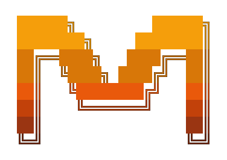
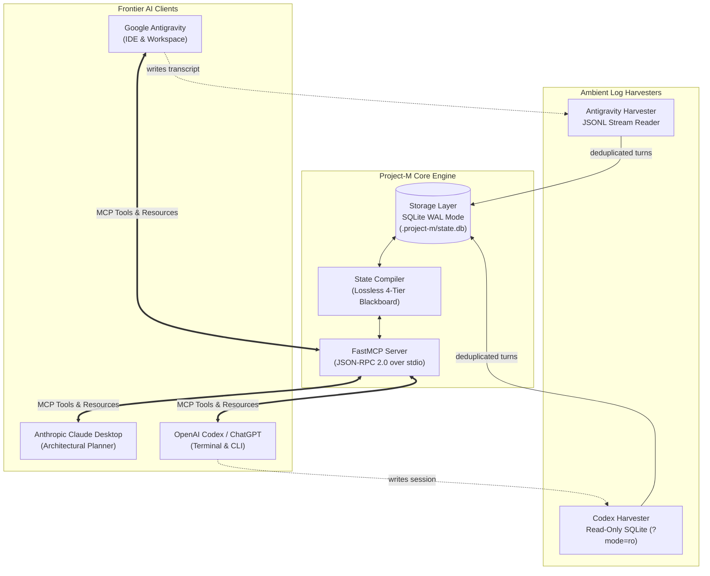

<div align="center">



# Project-M

### The Ambient, Local-First Context Engine & Blackboard for AI Agents

Switch between **Claude Desktop**, **OpenAI Codex**, and **Google Antigravity** without losing state.<br/>
Deterministic 4-tier context compilation. Sub-2ms latency. Zero cloud dependencies.

<br/>

[](https://github.com/adityadebnath009/Project-M)
[](https://www.python.org/)
[](https://modelcontextprotocol.io/)
[-3B82F6?style=for-the-badge&logo=sqlite&logoColor=white)](https://www.sqlite.org/)
[](https://github.com/adityadebnath009/Project-M)
[](LICENSE)

[](https://m8ven.ai/mcp/adityadebnath009-project-m-177ur4?s=readme)

<br/>

[Overview](#-overview) •
[Architecture](#-architecture) •
[Interactive REPL & CLI](#-developer-cli--interactive-repl) •
[FastMCP Tools](#-fastmcp-tools-reference) •
[Quickstart](#-quickstart) •
[Verification](#-verification--tests)

---

</div>

## 📌 Overview

Frontier software engineering in 2026 relies on a multi-agent stack:
* **Google Antigravity** for whole-repo refactoring, test harness execution, and deep agentic planning.
* **Anthropic Claude Desktop** for high-level architectural brainstorming, formal reasoning, and PR reviews.
* **OpenAI Codex / ChatGPT** for fast terminal scratchpads, bash script verification, and quick iterations.

### The Problem: Context Amnesia
Every time you switch between these assistants, **your context breaks**. Decisions agreed upon in Claude Desktop are invisible to Antigravity. Tasks started in Antigravity are unknown to Codex. Developers waste thousands of tokens and manual hours copy-pasting diffs, status updates, and architectural constraints across disconnected chat windows.

### The Solution: Project-M
**Project-M** is a local-first Model Context Protocol (MCP) server and verified project-state compiler. It passively harvests session turns, maintains an immutable ledger of Architectural Decision Records (ADRs), synchronizes task batons, and serves a deterministic **Tier 1 Briefing Card (< 450 tokens)** to any requesting AI agent in **under 2 milliseconds**.

* **100% Local**: Runs on SQLite WAL mode on your machine. No accounts, no telemetry, no cloud lock-in.
* **Zero API Costs**: No paid embedding syncs or third-party vector databases.
* **Lossless Telemetry**: Raw conversation logs are preserved permanently in Tier 4 cold storage while models only consume compressed, high-density state cards.
* **Clean Stdio Isolation**: MCP JSON-RPC 2.0 communication runs unpolluted over `stdout`, while branded status cards route safely to `stderr`.

---

## 🏗️ Architecture



### The 4-Tier Memory Hierarchy

| Tier | Name | Target Size | Latency | Purpose & Behavior |
| :--- | :--- | :--- | :--- | :--- |
| **Tier 1** | **Living State Card** | `< 450 tokens` | `< 2 ms` | Deterministic markdown briefing compiled via `tiktoken`. Injected automatically into every agent turn. Contains active goal, active stack, in-progress tasks, and recent ADRs. |
| **Tier 2** | **ADR Ledger** | `< 1,200 tokens` | `< 5 ms` | Immutable record of architectural decisions (`id`, `title`, `rationale`, `status`, `decided_by`). Prevents agents from reversing past architectural decisions. |
| **Tier 3** | **Task Baton Graph** | Dynamic | `< 5 ms` | Cross-agent task ownership (`task_id`, `status`, `assigned_to`, `notes`). Coordinates handoffs between `@claude`, `@antigravity`, and `@codex`. |
| **Tier 4** | **Lossless Cold Storage** | Unlimited | Indexed | Exact raw session transcripts (`transcript.jsonl` and session databases) preserved permanently with content hashes. Never sent to models directly; inspected on-demand via `get_turn()`. |

---

## 💻 Developer CLI & Interactive REPL

Project-M features a Claude-Code-inspired terminal interface with the official **Brutalist Chevron Monogram Logo**, live hardware specs, and a rich interactive REPL.

```
   ██████╗         ██████╗       adityadebnath@Project-M(MCP)  ● REPL ACTIVE
   ████████╗     ████████║       ──────────────────────────────────────────────
   ██╔══████╗   ████╔══██║       Engine:     4-Tier Lossless State Compiler
   ██║  ╚████╗ ████╔╝  ██║       Storage:    SQLite WAL (.project-m/state.db)
   ██║   ╚████████╔╝   ██║       Clients:    Claude Desktop • Codex • Antigravity
   ██║    ╚═══════╝    ██║       ADRs:       5 Accepted (Tier 2 Ledger)
   ██║                 ██║       Tasks:      1 in progress (Owner: @claude)
   ╚═╝                 ╚═╝       Telemetry:  424 raw turns recorded (Tier 4)
                                 Invariant:  100% Local • Zero Paid APIs
                                 Compile:    1.2ms latency (167/450 tokens)

                                 ● ● ● ● ● ● ● ●
  Type /help for commands  •  Press Tab to autocomplete  •  /exit to quit

project-m ❯ 
```

### REPL Slash Commands

Launch the interactive shell anytime with `uv run project-m` or `uv run project-m shell`:

| Command | Arguments | Description |
| :--- | :--- | :--- |
| `/board` | `[--target-tokens 450]` | Renders the compiled Tier 1 State Card in real time. |
| `/status` | — | Displays database size, WAL status, schema integrity, and active warnings. |
| `/tasks` | — | Displays the live task backlog with owner badges. |
| `/task` | `<id> <status> <@owner> <notes>` | Adds or updates a task baton (e.g. `/task auth-1 in_progress @claude "OAuth2"`). |
| `/decisions` | — | Lists all accepted Architectural Decision Records (ADRs). |
| `/decide` | `<id> <title> <rationale>` | Records a binding ADR (e.g. `/decide ADR-004 "Use SQLite WAL" "Zero locks"`). |
| `/fetch` | — | Displays the signature Neofetch-style system and compiler specifications. |
| `/export` | `[filename.md]` | Exports the living project state card to a portable Markdown document. |
| `/setup` | `[all \| claude \| codex]` | Runs the automated one-click client installer. |
| `/clear` | — | Clears the terminal screen. |
| `/exit` | — | Exits the shell cleanly. |

---

## ⚡ FastMCP Tools Reference

Project-M exposes 7 standard tools over Model Context Protocol:

| Tool | Parameters | Description |
| :--- | :--- | :--- |
| `get_project_board` | `target_tokens: int = 450` | Returns the deterministic Tier 1 Living State Card (< 450 tokens) containing current goal, tech stack, active tasks, and recent ADRs. |
| `record_decision` | `id, title, rationale, decided_by, status` | Posts a new Architectural Decision Record (ADR) to Tier 2. Prevents conflicting implementation paths. |
| `update_task` | `task_id, status, assigned_to, notes` | Updates or creates a task baton in Tier 3 (`pending`, `in_progress`, `completed`). |
| `publish_context` | `key, value, updated_by` | Updates blackboard key-values (`current_goal`, `active_stack`, `milestone`). |
| `get_recent_context` | `limit: int = 10` | Returns recent conversation turns across all clients (Tier 4 summary). |
| `get_turn` | `turn_id: int` | Fetches the full uncompressed raw prompt and completion payload for a specific turn. |
| `get_project_summary` | — | Returns diagnostic telemetry: database size, decision count, task counts, and turns. |

---

## 🚀 Quickstart

### Prerequisites
* **macOS / Linux / Windows**
* **Python 3.12+** (Tested on Python 3.14.7)
* [`uv`](https://github.com/astral-sh/uv) (Extremely fast Python package manager)

```bash
# 1. Clone repository
git clone https://github.com/adityadebnath009/Project-M.git
cd Project-M

# 2. Sync dependencies
uv sync

# 3. Launch the interactive REPL
uv run project-m
```

### One-Click AI Client Setup
Project-M configures your local AI assistants with automated timestamped backups (`.bak`):

```bash
# Configure all supported clients (Claude Desktop, Antigravity, Codex)
uv run project-m setup all

# Or configure a specific client:
uv run project-m setup claude
uv run project-m setup antigravity
uv run project-m setup codex
```

#### Manual Claude Desktop Configuration
If you prefer manual configuration, add Project-M to `~/Library/Application Support/Claude/claude_desktop_config.json` (macOS) or `%APPDATA%\Claude\claude_desktop_config.json` (Windows):

```json
{
  "mcpServers": {
    "project-m": {
      "command": "uv",
      "args": [
        "run",
        "--directory",
        "/path/to/Project-M",
        "project-m",
        "run"
      ]
    }
  }
}
```

---

## 🧪 Verification & Tests

Project-M includes an automated test suite verifying SQLite WAL concurrency, token ceiling constraints, JSONL stream parsers, FastMCP tool execution, and CLI command coverage:

```bash
uv run pytest -v
```

```text
============================= test session starts ==============================
platform darwin -- Python 3.14.7, pytest-9.2.0, pluggy-1.7.0
rootdir: /Users/adityadebnath/Projects/Project-M(MCP)
configfile: pyproject.toml
plugins: anyio-4.16.0, asyncio-1.4.1.post1
collected 64 items

tests/test_adapters.py ...........                                       [ 17%]
tests/test_blackboard.py ..........                                      [ 32%]
tests/test_cli.py ..........                                             [ 48%]
tests/test_server.py ........                                            [ 60%]
tests/test_storage.py .........................                          [100%]

============================== 64 passed in 0.99s ==============================
```

---

<div align="center">

### Built with care for multi-agent workflows.
**Project-M** is open-source under the [MIT License](LICENSE).

</div>
