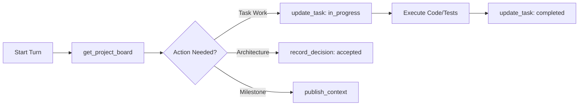

# Project-M: Multi-Agent Context Engine & Verified Blackboard

Use this skill to maintain continuous state, task ownership, and architectural invariants across heterogeneous AI assistants (Claude, Codex, Antigravity) without token waste or cloud dependencies.

---

## Invocation Triggers

Activate this skill immediately whenever:
- **Starting a session or new task**: Read the current repo goal, stack, active tasks, and recent ADRs before writing code.
- **Making an architectural decision**: Persist decisions on libraries, schemas, protocols, or structural patterns so peer agents never reverse them.
- **Passing a task baton**: Claim, update, or hand off in-progress tasks between assistants (`@claude`, `@antigravity`, `@codex`).
- **Publishing repository milestones**: Broadcast changes to primary goals or active tech stacks.

---

## Operational Workflow



### Step 1: Orientation & State Synchronization

On your first turn in a repository or when beginning a new milestone, fetch the live **Tier 1 Living State Card**:

```json
// Tool: get_project_board
{
  "target_tokens": 450
}
```

#### Completion Criteria:
1. Identify the active `Goal` and `Stack`.
2. Inspect `Active Tasks` to avoid duplicating work owned by another assistant.
3. Review `Accepted Decisions (ADRs)`: Never propose or implement solutions that contradict accepted ADRs.

---

### Step 2: Claiming and Updating Task Batons

Coordinate cross-agent work through **Tier 3 Task Batons**:

#### Claiming a Task:
When beginning work on a pending item or declaring a new task:
```json
// Tool: update_task
{
  "task_id": "auth-oauth2-flow",
  "status": "in_progress",
  "assigned_to": "antigravity",
  "notes": "Implementing PKCE authorization handler in src/auth.py"
}
```

#### Completing a Task:
When tests pass and implementation is complete:
```json
// Tool: update_task
{
  "task_id": "auth-oauth2-flow",
  "status": "completed",
  "assigned_to": "antigravity",
  "notes": "Verified with 12 unit tests passing."
}
```

---

### Step 3: Binding Architectural Decisions (ADRs)

Prevent context fragmentation and architectural flip-flops across sessions. Whenever choosing a library, database strategy, serialization format, or API boundary, record an immutable ADR into **Tier 2**:

```json
// Tool: record_decision
{
  "id": "ADR-006",
  "title": "Use SQLite Write-Ahead Logging (WAL) Mode for Multi-Process Access",
  "rationale": "Allows concurrent read-only queries from multiple AI clients without blocking writer processes or requiring server daemons.",
  "decided_by": "claude",
  "status": "accepted"
}
```

#### Rules for ADRs:
- **Immutable by Default**: Do not overwrite or delete an accepted ADR.
- **Superseding**: To alter an existing decision, record a new ADR explicitly referencing the superseded ID (e.g. `Supersedes ADR-002: migrated from REST to JSON-RPC`).

---

### Step 4: Broadcasting Blackboard Context

Update core project invariants when milestone objectives evolve:

```json
// Tool: publish_context
{
  "key": "current_goal",
  "value": "Phase 5 Complete: Package v0.1.0 and distribute FastMCP server",
  "updated_by": "codex"
}
```

Standard Keys:
- `current_goal`: Single sentence stating the current operational objective.
- `active_stack`: Comma-separated list of active technologies (e.g. `Python 3.14, FastMCP, SQLite WAL, Rich, Click`).
- `milestone`: Target delivery release (e.g. `v0.1.0`).

---

### Step 5: Lossless Deep Inspection (On-Demand Only)

Tier 1 state cards are deliberately token-dense (< 450 tokens). If detailed verbatim dialogue from a past agent session is required for debugging:

1. Call `get_recent_context(limit=5)` to list recent cross-agent turn IDs and timestamps.
2. Call `get_turn(turn_id=<id>)` to retrieve the uncompressed raw prompt and completion payload.

---

## Frontier Agent Invariants

1. **Zero Cloud Leaks**: Project-M operates 100% locally on `.project-m/state.db`. Never transmit state data to external cloud APIs or third-party vector databases.
2. **Deterministic Token Economy**: Never inflate Tier 1. State cards are strictly budget-capped (< 450 tokens via `tiktoken`) so prompts remain focused on actual code.
3. **Stdio Integrity**: When running the FastMCP server, ensure `stdout` carries only valid JSON-RPC 2.0 messages; all user-facing terminal banners and logs must route exclusively to `stderr`.
4. **Verifiable Completion**: An agent task is only marked `completed` once verifiable code, schemas, or passing unit tests are produced.
